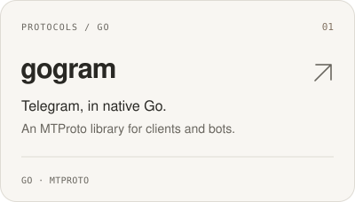
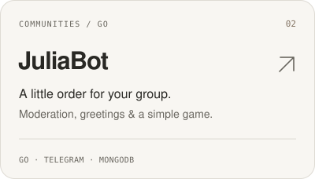
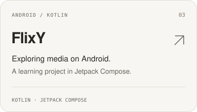
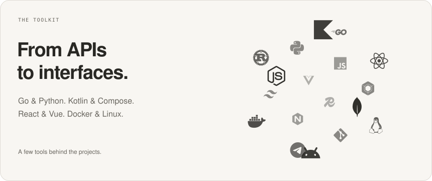

  <picture>
    <source media="(max-width: 600px) and (prefers-color-scheme: dark)" srcset="assets/header-dark-mobile.svg">
    <source media="(max-width: 600px)" srcset="assets/header-light-mobile.svg">
    <source media="(prefers-color-scheme: dark)" srcset="assets/header-dark.svg">
    
  </picture>

I like understanding how things work, then building something useful with them. Most of my work lives around **Go**, **Telegram**, and **Android** — from protocol libraries to the apps and bots built on top.

[Telegram](https://t.me/roseloverx) &nbsp; · &nbsp; [LinkedIn](https://www.linkedin.com/in/amarnathcdj/) &nbsp; · &nbsp; [X](https://x.com/ama_xnath) &nbsp; · &nbsp; [Writing](https://dev.to/amarnathcjd)

## Top projects

  <a href="https://github.com/xAmarnath/gogram"><picture><source media="(prefers-color-scheme: dark)" srcset="assets/project-gogram-dark.svg"></picture></a>
  <a href="https://github.com/xAmarnath/JuliaBot"><picture><source media="(prefers-color-scheme: dark)" srcset="assets/project-juliabot-dark.svg"></picture></a>
  <a href="https://github.com/xAmarnath/FlixY"><picture><source media="(prefers-color-scheme: dark)" srcset="assets/project-flixy-dark.svg"></picture></a>
  <a href="https://github.com/xAmarnath/CloudTorrent"><picture><source media="(prefers-color-scheme: dark)" srcset="assets/project-cloudtorrent-dark.svg"></picture></a>

[All repositories ↗](https://github.com/xAmarnath?tab=repositories)

## Stack

  <picture>
    <source media="(max-width: 600px) and (prefers-color-scheme: dark)" srcset="assets/stack-dark-mobile.svg">
    <source media="(max-width: 600px)" srcset="assets/stack-light-mobile.svg">
    <source media="(prefers-color-scheme: dark)" srcset="assets/stack-dark.svg">
    
  </picture>

## On GitHub

  <a href="https://github.com/xAmarnath?tab=repositories"><picture><source media="(prefers-color-scheme: dark)" srcset="https://github-readme-stats-alpha-snowy-32.vercel.app/api?username=xAmarnath&amp;show_icons=true&amp;hide_rank=true&amp;hide=issues%2Ccontribs&amp;line_height=30&amp;custom_title=Public%20activity&amp;card_width=400&amp;bg_color=191a1b&amp;title_color=edeae4&amp;text_color=b1ada5&amp;icon_color=bbae9c&amp;border_color=363738&amp;border_radius=18&amp;disable_animations=true"></picture></a>
  <a href="https://github.com/xAmarnath?tab=repositories"><picture><source media="(prefers-color-scheme: dark)" srcset="https://github-readme-stats-alpha-snowy-32.vercel.app/api/top-langs/?username=xAmarnath&amp;layout=compact&amp;langs_count=6&amp;custom_title=Languages%20in%20public%20repos&amp;card_width=400&amp;bg_color=191a1b&amp;title_color=edeae4&amp;text_color=b1ada5&amp;icon_color=bbae9c&amp;border_color=363738&amp;border_radius=18&amp;disable_animations=true"></picture></a>

